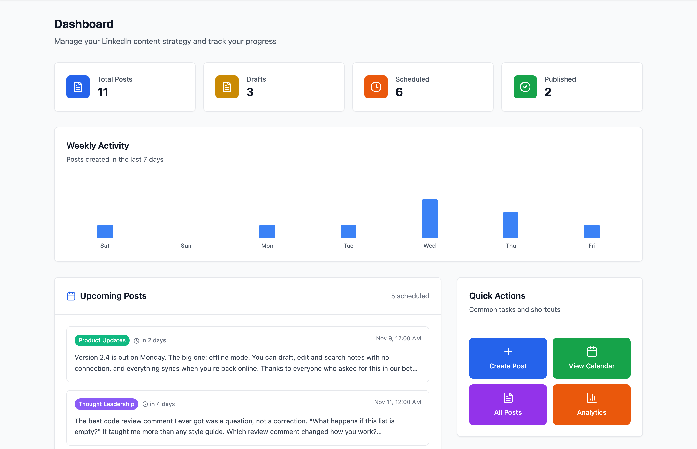
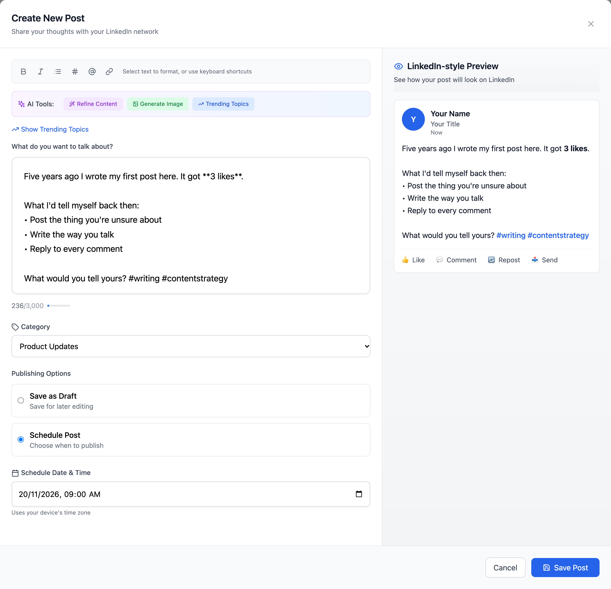
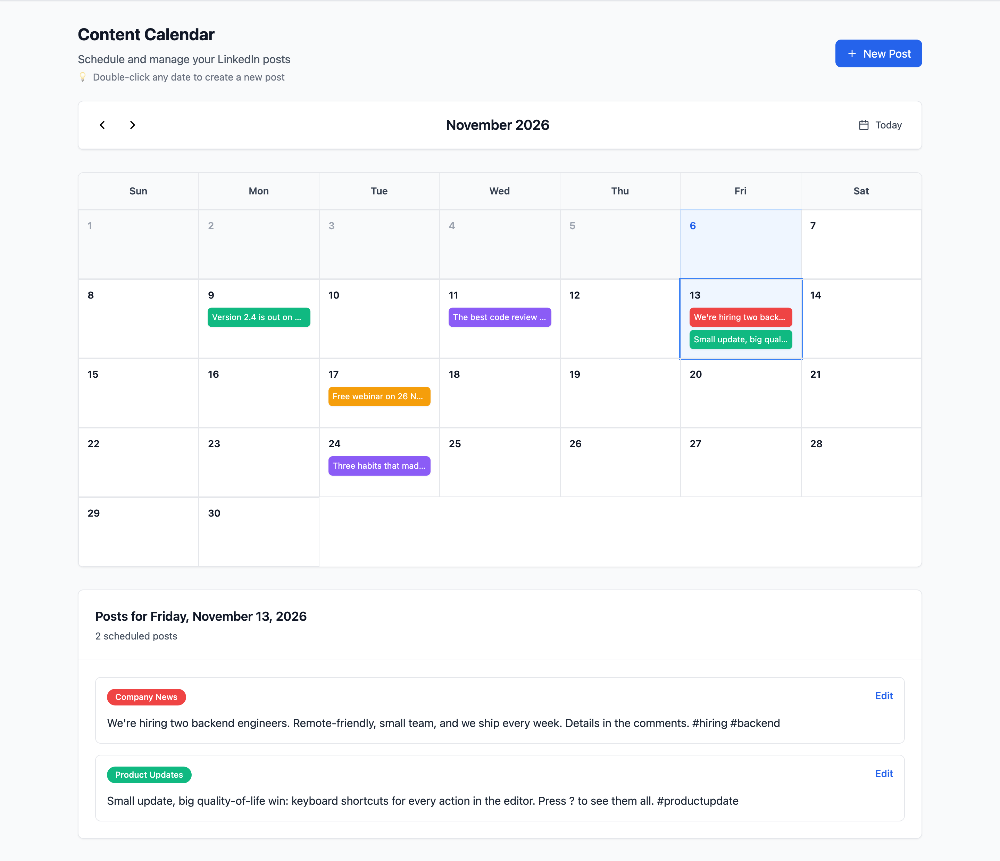
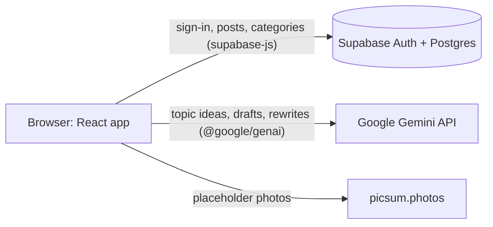

# Content Planner for LinkedIn: open-source post planner and content calendar, with Gemini AI writing help

[](https://github.com/hanshika0292/linkedin-content-planner/actions/workflows/ci.yml)
[](LICENSE)


**A free, open-source (MIT) web app for planning LinkedIn posts: keep a draft library, see a LinkedIn-style preview as you write, plan posts on a content calendar, and get topic ideas and rewrites from Google Gemini.** It is a planner, not an auto-poster. It never connects to LinkedIn: "scheduling" a post saves a planned date in your own Supabase database, and you publish on LinkedIn yourself. Built with React, TypeScript, Vite, Tailwind CSS and Supabase.

> Independent project. Not affiliated with, endorsed by or sponsored by LinkedIn or Google.

<p align="center">
  
</p>

Posting on LinkedIn regularly means juggling ideas, half-written drafts and a posting plan across notes apps and documents. This app keeps every post in one place and answers the everyday questions:

- **What's ready, and what's planned for which day?** Every post has a status (draft, scheduled or published), a category and a planned date.
- **What does my month look like?** A content calendar shows planned posts on their day, colored by category.
- **How will this look in the feed?** A live, LinkedIn-style preview sits next to the editor, with a 3,000-character counter.
- **What should I write about?** Gemini suggests topic ideas and can draft a post from one.
- **Can this be clearer, shorter or more engaging?** Eight Gemini rewrite modes, with the original kept until you accept the new version.

## Contents

- [Features](#features) · [Quick start](#quick-start) · [Configuration](#configuration) · [How it works](#how-it-works)
- [FAQ](#faq) · [Status and limitations](#status-and-limitations) · [Contributing](#contributing) · [Credits](#credits) · [License](#license)

Screenshots show the real app with fictional sample data.

## Features

**Accounts and data**

- Email and password sign-up and sign-in through Supabase Auth.
- Posts and categories are stored in Supabase Postgres and loaded per user.
- New users get four color-coded categories: Product Updates, Marketing, Thought Leadership and Company News.

**Dashboard**

- Counts of total, draft, scheduled and published posts. Clicking a count opens the Posts or Calendar view.
- A bar chart of posts created on each of the last 7 days.
- The next 5 scheduled posts, with "in 2 days" style countdowns. Past-due posts are marked "overdue" in red.
- The 6 most recently updated posts, plus "this week" and "this month" counts.
- A trending-topics panel (see AI features below).

**Post editor with live preview**

<p align="center">
  
</p>

- A 3,000-character limit with a live counter that turns amber near the limit and red over it.
- A formatting toolbar for bold, italic, bullet points, hashtags, mentions and links. Keyboard shortcuts: Ctrl/Cmd+B, Ctrl/Cmd+I, and Ctrl/Cmd+S to save.
- A side-by-side preview styled like a LinkedIn post, with highlighted hashtags, mentions and links. Post text is HTML-escaped before formatting, so any markup in a post shows up as plain text.
- A category picker, and a choice between saving as a draft or scheduling with a date and time picker (minimum one hour from now).

**Content calendar**

<p align="center">
  
</p>

- A month grid that shows scheduled posts on their day, colored by category (up to 3 per day, then "+N more").
- Click a day to list its posts below the grid. Double-click a day to open the editor with that date prefilled at 09:00.
- Previous/next month and "Today" navigation.

**Posts library**

- A card grid of all posts, newest update first.
- Search by text, and filter by status (defaults to Drafts) and by category.
- Edit, duplicate (as a new draft), delete (with confirmation) and mark as published.

**AI features (Google Gemini)**

- **Trending topics:** asks Gemini for 10 LinkedIn topic ideas for today's date. Each comes with a category, hashtags and a suggested angle. These are ideas written by the model, not live trend data.
- **Generate a post from a topic:** in the editor, pick a topic and Gemini drafts a 150 to 300 word post with hashtags.
- **Refine content:** eight rewrite modes: improve clarity, make more engaging, professional tone, add storytelling, add a call to action, optimize hashtags, make concise, and add more detail. You see the rewrite below the original and choose to use it, go back, or try another mode.
- **Image generation (mocked):** "From content" asks Gemini to describe a suitable image. The image itself is a random stock photo from picsum.photos. "Custom prompt" does not call Gemini at all. See [Status and limitations](#status-and-limitations).

The AI features use `gemini-3.8-flash` by default. Set `VITE_GEMINI_MODEL` to use a different Gemini model (see [Configuration](#configuration)).

## Quick start

You need Node.js 20 or newer with npm, a [Supabase](https://supabase.com) project, and (only for the AI features) a Google Gemini API key.

```bash
git clone https://github.com/hanshika0292/linkedin-content-planner.git
cd linkedin-content-planner
npm install
cp .env.example .env   # then fill in the values, see Configuration
```

**Set up the database.**

1. Open your Supabase project and go to the SQL Editor.
2. Run the contents of [`supabase/setup.sql`](supabase/setup.sql). It creates the `categories` and `posts` tables.
3. Recommended: turn on Row Level Security so each user can only reach their own rows. `setup.sql` does not do this for you.

   ```sql
   alter table categories enable row level security;
   alter table posts enable row level security;

   create policy "Users manage their own categories" on categories
     for all using (auth.uid() = user_id) with check (auth.uid() = user_id);

   create policy "Users manage their own posts" on posts
     for all using (auth.uid() = user_id) with check (auth.uid() = user_id);
   ```

4. Supabase asks new users to confirm their email by default, and the app does not show a "check your inbox" message after sign-up. For local testing, either click the confirmation link or turn off email confirmation in the Authentication settings.

**Run it.**

```bash
npm run dev
```

Open http://localhost:5173 and sign up on the first screen. Your default categories are created on first load.

| Command | What it does |
| --- | --- |
| `npm run dev` | Start the Vite dev server (http://localhost:5173 by default) |
| `npm run build` | Build for production into `dist/` |
| `npm run preview` | Serve the production build locally |
| `npm run lint` | Run ESLint |
| `npm test` | Run the unit tests once (Vitest) |

## Configuration

All settings are environment variables in `.env` (copied from [`.env.example`](.env.example)):

| Variable | Required | Example value | Where to get it |
| --- | --- | --- | --- |
| `VITE_SUPABASE_URL` | Yes | `https://your-project-ref.supabase.co` | Your Supabase project's API settings (Project URL) |
| `VITE_SUPABASE_ANON_KEY` | Yes | `your-supabase-anon-key` | The same page: the `anon` public key (newer projects call it the publishable key). Never use the `service_role` or secret key here. |
| `VITE_GEMINI_API_KEY` | No | `your-gemini-api-key` | Google AI Studio, "Get API key" |
| `VITE_GEMINI_MODEL` | No | `gemini-3.8-flash` | The Gemini model to call. Leave it unset to use the default (`gemini-3.8-flash`). Set it when Google retires that model; current names are on Google's [models page](https://ai.google.dev/gemini-api/docs/models) and retirement dates on the [deprecations page](https://ai.google.dev/gemini-api/docs/deprecations). |

If either Supabase variable is missing, the app throws "Missing Supabase environment variables" at startup and the page stays blank (the message is in the browser console). Without the Gemini key it still runs, and the AI panels show a "Gemini API not configured" message.

All of these values are read in the browser (`VITE_` prefix), so they end up in the built JavaScript. That is expected for the Supabase anon key. See the limitations below about the Gemini key.

## How it works

The app is a single-page React app with no backend of its own. The browser talks directly to Supabase and Google Gemini. Nothing talks to LinkedIn.



- **Supabase** handles sign-in (`supabase.auth`) and reading and writing the `posts` and `categories` tables through `@supabase/supabase-js`. Every query filters by the signed-in user's ID.
- **Google Gemini** (`gemini-3.8-flash` unless `VITE_GEMINI_MODEL` names another model, through Google's `@google/genai` SDK) produces topic ideas, post drafts, rewrites and image descriptions. All prompts live in `src/lib/gemini.ts`. The SDK is loaded in its own chunk the first time an AI feature is used, so it does not slow down the first page load.

Inside the app:

- `App.tsx` shows the sign-in form until Supabase reports a session, then renders the main shell.
- `AppContext` (React Context with `useReducer`) holds the current view (dashboard, calendar or posts), the selected calendar date and the status filter. It also exposes the `usePosts` and `useCategories` hooks, which own all database reads and writes. There is no router; views switch through context state.
- Small hooks keep logic out of the components: `use-dashboard-stats` (counts, chart data, upcoming and recent posts), `use-calendar` and `use-calendar-posts` (month grid and posts by day), `use-post-filters` (search and filters), `use-post-actions` (save, duplicate, delete, publish) and `use-text-formatting` (toolbar edits at the cursor).
- Dates use the browser's time zone. A scheduled date is treated as a calendar day, not converted through UTC, so a post planned for 20 November shows on 20 November in every time zone, and the calendar highlights your local today (`src/utils/date-utils.ts`).

**What "scheduled" means.** Choosing "Schedule Post" sets the post's status to `scheduled` and saves the chosen date. The post then appears on the calendar and in the dashboard's upcoming list. Nothing runs in the background: there is no auto-posting, no reminder email and no notification. When you have posted it on LinkedIn yourself, click "Mark as published" in the Posts view, which only changes the status in the database.

**Data model** (`supabase/setup.sql`)

| Table | Columns |
| --- | --- |
| `categories` | `id`, `name`, `color`, `user_id`, `created_at` |
| `posts` | `id`, `content`, `category` (references `categories`), `scheduled_date`, `status` (`draft`, `scheduled` or `published`), `media_type`, `media_url`, `media_alt`, `user_id`, `created_at`, `updated_at` |

**Tech stack:** React 18 and TypeScript, Vite 6, Tailwind CSS 3, lucide-react icons, Supabase (Auth and Postgres) with `@supabase/supabase-js` v2, Google Gemini with `@google/genai`, Vitest for unit tests, and ESLint 9 with `typescript-eslint` and React Hooks rules.

### Project structure

```
.
├── index.html
├── public/
│   └── favicon.svg
├── supabase/
│   └── setup.sql                  # Table definitions
└── src/
    ├── App.tsx                    # Auth gate and view switch
    ├── main.tsx
    ├── context/
    │   ├── AppContext.tsx         # Provider: view, date and filter state; posts and categories hooks
    │   └── use-app.ts             # The context and the useApp() hook
    ├── components/
    │   ├── AuthForm.tsx           # Sign in / sign up
    │   ├── Header.tsx             # Navigation and sign out
    │   ├── Dashboard.tsx          # Stats, activity chart, upcoming and recent posts
    │   ├── Calendar.tsx           # Month view (calendar-grid, calendar-header, selected-date-posts)
    │   ├── Posts.tsx              # Library (posts-header, posts-filters, posts-grid, PostCard)
    │   ├── PostEditor.tsx         # Editor modal (formatting-toolbar, character-counter)
    │   ├── linkedin-post-preview.tsx
    │   ├── TrendingTopics.tsx     # Gemini topic ideas
    │   ├── ContentRefinement.tsx  # Gemini rewrites
    │   ├── ImageGenerator.tsx     # Image picker (placeholder images)
    │   └── ...                    # Smaller dashboard cards and empty states
    ├── hooks/                     # Data hooks (usePosts, useCategories, useAuth, useTrendingTopics) and UI logic hooks
    ├── lib/
    │   ├── supabase.ts            # Supabase client and table types
    │   └── gemini.ts              # Gemini client, model setting, prompts, refinement options
    ├── types/index.ts             # Post, Category, ViewMode, PostFilter
    └── utils/
        ├── date-utils.ts          # Calendar-day, picker and relative-date helpers
        └── format-linkedin-content.ts  # Preview formatting (escapes HTML first)
```

Unit tests sit next to the code they cover: `src/utils/date-utils.test.ts`, `src/utils/format-linkedin-content.test.ts` and `src/lib/gemini.test.ts`.

## FAQ

**Does it post to LinkedIn automatically?**
No. The app has no LinkedIn connection, no LinkedIn login and no posting API. "Scheduled" is a planning status with a date. You copy the post into LinkedIn yourself and then mark it as published.

**Will it remind me when a scheduled post is due?**
No. There are no emails or notifications. The dashboard lists the next 5 scheduled posts and marks past-due ones as "overdue".

**Are the "trending topics" real LinkedIn trends?**
No. They are ideas that Gemini writes from a prompt that includes today's date. They do not come from LinkedIn or any live trend source.

**Can I use it without a Gemini API key?**
Yes. Leave `VITE_GEMINI_API_KEY` empty. Drafts, the preview, the calendar and the posts library work without it; only the AI panels show an error.

**Is it free?**
The app is free and open source under the MIT License. You run it with your own Supabase project and, for the AI features, your own Gemini API key, so those services' own pricing applies.

**Where is my data stored, and who can see it?**
In your own Supabase project. Turn on Row Level Security with the snippet in [Quick start](#quick-start) so each account can only reach its own rows. When you use an AI feature, the post text or topic is sent to the Gemini API.

**Which time zone does it use?**
Your browser's. A scheduled date is a calendar day, so a post planned for 20 November shows on 20 November wherever you open the app, and "today" is your local today.

**Can I deploy it for other people to use?**
It was built as a personal tool. Before a public deployment, turn on Row Level Security and move the Gemini calls behind a server function so the API key is not in the browser bundle.

## Status and limitations

This is a working personal project, not a finished product. `npm test`, `npm run lint`, the TypeScript check (`npx tsc -p tsconfig.app.json --noEmit`) and `npm run build` all pass. The unit tests cover the date helpers (run in several time zones), the preview formatter and the Gemini requests. The Gemini tests use a stubbed network, so they check the request the app sends and how it reads the reply, not the live API. The rest of the app has been checked by hand.

**What it does not do**

- It does not connect to LinkedIn. Nothing is posted for you. "Scheduled" is a planning label, and "Mark as published" only changes the status in the database.
- Image generation is a placeholder. The saved image is a random photo from picsum.photos, and the style choice is not used. Saved images are also not shown on post cards or in the preview.
- Trending topics are ideas generated by Gemini from a prompt. They do not come from LinkedIn or any live trend source.

### Known gaps

- On the dashboard, the "Create Post" and "Analytics" quick actions, opening an upcoming or recent post, and picking a trending topic are not wired up. They log to the console, or switch to the Posts view without opening the editor. Generating a post from a topic works inside the editor.
- There is no screen for adding or renaming categories, only the four defaults. (`useCategories` has an `addCategory` function that no screen calls yet.)
- The "Forgot password?" link does nothing.
- In `setup.sql`, `scheduled_date` is a `date` column, so the time picked in the editor is not stored and the app shows only the date. Keeping the time would need a `timestamptz` column and the editor sending the time with its UTC offset; the date helpers already read such values.
- The editor offers only Draft and Scheduled, so opening a published post in the editor sets it back to Scheduled.
- The `Post` type has fields for AI image metadata and refinement history, but there are no database columns for them, so they are not saved.
- `PostPreview.tsx` (a 210-character "See more" preview) is not used anywhere.

### Security and configuration

- `setup.sql` does not enable Row Level Security. The app filters every query by user ID, but only the database can enforce that. Run the policy snippet in [Quick start](#quick-start) before storing real data.
- Gemini is called from the browser, so `VITE_GEMINI_API_KEY` ships in the client bundle. That is fine for local use. For a public deployment, move the Gemini calls behind a server function.
- Bold and italic use Markdown-style `**` and `*` markers. LinkedIn does not render Markdown, so these only look bold or italic in the preview.

## Contributing

Issues and pull requests are welcome. Useful places to start are the [Known gaps](#known-gaps): the unwired dashboard actions, a category editor, the "Forgot password?" link and keeping the scheduled time. Please run `npm test`, `npm run lint`, `npx tsc -p tsconfig.app.json --noEmit` and `npm run build` before opening a pull request.

By contributing, you agree that your contributions are licensed under the MIT License.

## Credits

Built on [React](https://react.dev), [Vite](https://vitejs.dev), [TypeScript](https://www.typescriptlang.org), [Tailwind CSS](https://tailwindcss.com), [Lucide](https://lucide.dev) icons, [Supabase](https://supabase.com) and the [Google Gemini API](https://ai.google.dev) through `@google/genai`. Tests run on [Vitest](https://vitest.dev). Placeholder images come from [Lorem Picsum](https://picsum.photos). Nothing is vendored; see [THIRD_PARTY_NOTICES.md](THIRD_PARTY_NOTICES.md).

## License

Released under the [MIT License](LICENSE). Copyright (c) 2026 Hanshika Gupta.

You can use, copy, modify and redistribute it, including commercially, as long as you keep the copyright and license notice. The software comes with no warranty.

LinkedIn is a trademark of LinkedIn Corporation, and Google and Gemini are trademarks of Google LLC. They are named only to describe what this app works with. This project is not affiliated with, endorsed by or sponsored by either company.
